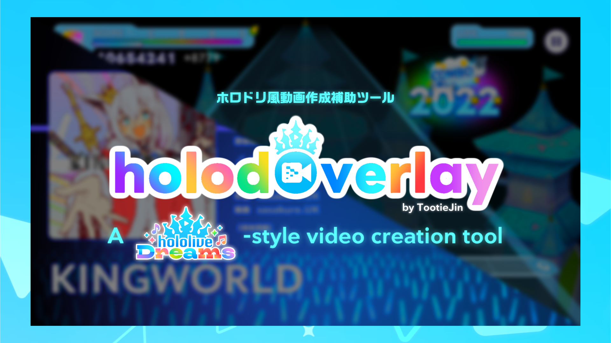
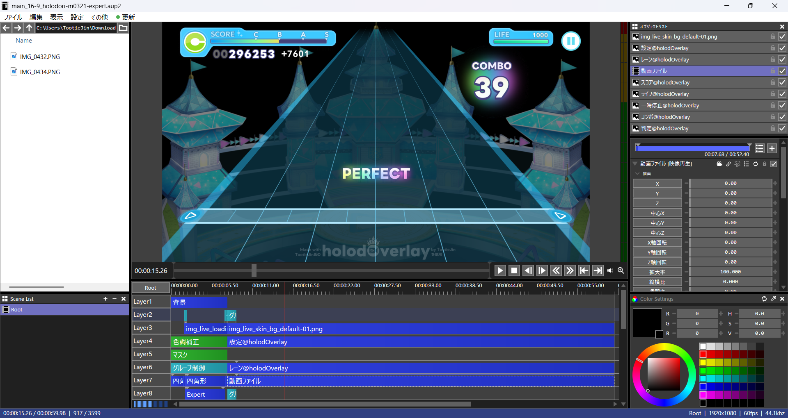

<p align="center">
  <strong>English | <a href="./README-ja.md">日本語</a></strong>
</p>

<h1 align="center">
  <br>
  holodOverlay
</h1>

<p align="center">
  ホロドリ風動画作成補助ツール<br>
  A "hololive Dreams"-style video creation tool
</p>

<p align="center">
  
  <a href="./LICENSE"></a> 
  <a href="https://github.com/TootieJin/holodOverlay/releases/"></a> 
  <a href="https://github.com/TootieJin/holodOverlay/stargazers"></a>
</p>

<p align="center">
    <a href="https://ko-fi.com/TootieJin">
      
    </a>
</p>

<p align="center">
  
</p>

# holodOverlay / A "hololive Dreams"-style video creation tool

**holodOverlay by [TootieJin](https://tootiejin.com)** is an open-sourced tool to make <u>hololive Dreams Fanmade (custom chart) videos</u>. This tool provides an identical look to how custom charts should look like in the official game, while giving users the ability to 'manipulate' their UI (or HUD) using the video editor (AviUtl ExEdit2).

## Key Features
This repo is a holodori-variant of another tool called [pjsekai-overlay-APPEND](https://github.com/TootieJin/pjsekai-overlay-APPEND), with additional features including:
- Added/adjusted elements to look identical to the official photography
- Full English support in AviUtl ExEdit2
- **Dynamic Lane** (Experimental)
- **Custom Live Skin** (more in the [Usage Guide](#usage-guide))
- Various UI Customizations:
  - Choose from **more than 50+ Live Skins** *(for free, no need to pay ¥290/month lol)*
  - Rank scores can go <u>beyond S+9</u>, and can add additional "+" to other ranks as well
  - Animated LIFE bar
  - Interchangable elements (Score/Combo/Pause/etc.)
- **Server Lists**
  - **hololive Dreams**
    - <u>Official server(s):</u>
      - `holodori-`: hololive Dreams Unofficial Database ([sonolus.holodori.best](https://sonolus.holodori.best))
    - <u>Custom server(s):</u>
      - Oops. None yet!
  - **Project Sekai**
    - <u>Official server(s):</u>
      - `sekai-best-`: Sekai Viewer ([sonolus.sekai.best](https://sonolus.sekai.best))
      - `sss-`: Sbuga's Sonolus Server ([sonolus.sbuga.com](https://sonolus.sbuga.com))
    - <u>Custom server(s):</u>
      - `chcy-`: Chart Cyanvas
        - `0`: Archive ([cc.milkbun.org](https://cc.milkbun.org))
        - `1`: Offshoot server ([chart-cyanvas.com](https://chart-cyanvas.com))
      - `ptlv-`: Potato Leaves ([ptlv.milkbun.org](https://ptlv.milkbun.org))
      - <del>`utsk-`: Untitled Sekai ([us.pim4n-net.com](https://us.pim4n-net.com))</del>
      - `UnCh-`: UntitledCharts ([untitledcharts.com](https://untitledcharts.com))
    - <u>Local server(s):</u>
      - `sync-`: Local Server ([ScoreSync](https://github.com/Piliman22/ScoreSync) + [ScoreSync Modern](https://github.com/UntitledCharts/ScoreSync-Modern))
  - **Others**
    - `custom-[Chart ID]`: Custom Server (Source URL)

### • holodOverlay Preview

https://github.com/user-attachments/assets/d83ed282-73db-417d-b25c-c5a701635bcc

### • AviUtl ExEdit2 Preview



## Terms of Use

1. **(REQUIRED)** In the description of your video, you must copy the text here:

**EN**
```
holodOverlay - holodori-style video creation tool:
- Developed by TootieJin (https://tootiejin.com) 
   https://github.com/TootieJin/holodOverlay
```

**JP**
```
holodOverlay - ホロドリ風動画作成補助ツール：
- 作成：TootieJin (https://tootiejin.com)
   https://github.com/TootieJin/holodOverlay
```

2. This tool **should not be used for malicious purposes** (such as spreading misinformation on social media).
3. The author **assumes no responsibility whatsoever** for any issues or disadvantages arising from the use of this tool.

## Requirements
- [AviUtl ExEdit2 **(via installer)**](http://spring-fragrance.mints.ne.jp/aviutl/) *(After installing AviUtl ExEdit2, open `holodOverlay.exe` to automatically download essential plugins. You'll need to restart AviUtl ExEdit2 after this.)* 
  - English language can be selected in `設定 > 言語の設定 > English` (`Settings > Language > English`)
- **[PowerShell](https://github.com/PowerShell/PowerShell)**
- Your system locale **must be `Japanese (Japan)`** (You can do this in holodOverlay, or [go here](https://github.com/TootieJin/pjsekai-overlay-APPEND/wiki/Start-Here!#changing-system-locale) to adjust on your own.)
- Basic knowledge of AviUtl ExEdit2
  - [Go here](https://www.youtube.com/playlist?list=PLjvcc2yii9PIr27ZsMzKymY2qST3GFF_M) for the JP Video Guide playlist. (recommended)
  - [Go here](https://note.com/hikami_meruru/n/na72411631b95?hl=en) for the AviUtl2 Essential Tips blog (2026, JP, EN translation available)
  - [Go here](https://www.youtube.com/playlist?list=PLKIaXWZCUwrvfr3WNG9P81aVvuCHRJXUZ) for the EN Video Guide playlist.
  - [Go here](https://docs.aviutl2.jp/en/usage) for the Quick Guide docs in AviUtl ExEdit2.

> [!CAUTION]
> Unlike [pjsekai-overlay-APPEND](https://github.com/TootieJin/pjsekai-overlay-APPEND), this tool **does not support AviUtl** (old version).

## Usage Guide

Work in progress.

> [!NOTE]
> Please check the wiki often, as we may update information.

## License
This software is released under the GNU Affero General Public License (GNU AGPL).

```
GNU Affero General Public License v3.0

holodOverlay - A "hololive Dreams"-style video creation tool
Copyright (C) 2026 TootieJin

This program is free software: you can redistribute it and/or modify
it under the terms of the GNU Affero General Public License as published
by the Free Software Foundation, either version 3 of the License, or
(at your option) any later version.

This program is distributed in the hope that it will be useful,
but WITHOUT ANY WARRANTY; without even the implied warranty of
MERCHANTABILITY or FITNESS FOR A PARTICULAR PURPOSE. See the
GNU Affero General Public License for more details.

You should have received a copy of the GNU Affero General Public License
along with this program. If not, see <https://www.gnu.org/licenses/>.
```