# Requirements
- [AviUtl ExEdit2 **(via installer)**](http://spring-fragrance.mints.ne.jp/aviutl/) *(After installing AviUtl ExEdit2, open `holodOverlay.exe` to automatically download essential plugins. You'll need to restart AviUtl ExEdit2 after this.)* 
  - English language can be selected in `設定 > 言語の設定 > English` (`Settings > Language > English`)
- **[PowerShell](https://github.com/PowerShell/PowerShell)**
- Your system locale **must be `Japanese (Japan)`** (You can do this in holodOverlay, or [go here](https://github.com/TootieJin/pjsekai-overlay-APPEND/wiki/Start-Here!#changing-system-locale) to adjust on your own.)
- Basic knowledge of AviUtl ExEdit2
  - [Go here](https://www.youtube.com/playlist?list=PLjvcc2yii9PIr27ZsMzKymY2qST3GFF_M) for the JP Video Guide playlist. (recommended)
  - [Go here](https://note.com/hikami_meruru/n/na72411631b95?hl=en) for the AviUtl2 Essential Tips blog (2026, JP, EN translation available)
  - [Go here](https://www.youtube.com/playlist?list=PLKIaXWZCUwrvfr3WNG9P81aVvuCHRJXUZ) for the EN Video Guide playlist.
  - [Go here](https://docs.aviutl2.jp/en/usage) for the Quick Guide docs in AviUtl ExEdit2.

> [!CAUTION]
> Unlike [pjsekai-overlay-APPEND](https://github.com/TootieJin/pjsekai-overlay-APPEND), this tool **does not support AviUtl** (old version).

# Video Guide
You'll need a clean recording that has BLACK background & ALL UI hidden (including lanes) like in the screenshot below:

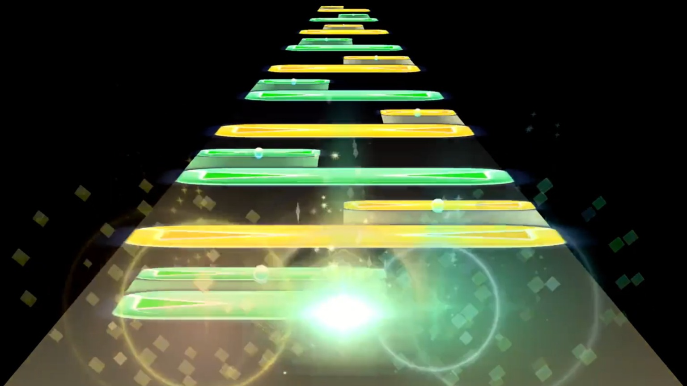<br>

## Sonolus
<br>

Follow the steps below:

0. <u>(If you're not using a custom holodori server to record)</u> Add `sonolus.holodori.best` to your custom server list in [Sonolus](https://sonolus.com/).
1. Go to [Sonolus](https://sonolus.com/) to find your chart.
2. <u>(If you're not using a custom holodori server to record)</u> Change your skin & SFX to the one provided by the `sonolus.holodori.best` server

> [!NOTE]
> To change to holodori skin/SFX, go to `Configuration > Skin > Select`, go back ONCE (this will navigate you to which server to select skin/SFX), then go to hololive Dreams (`sonolus.holodori.best`) to change skin/SFX from there<br>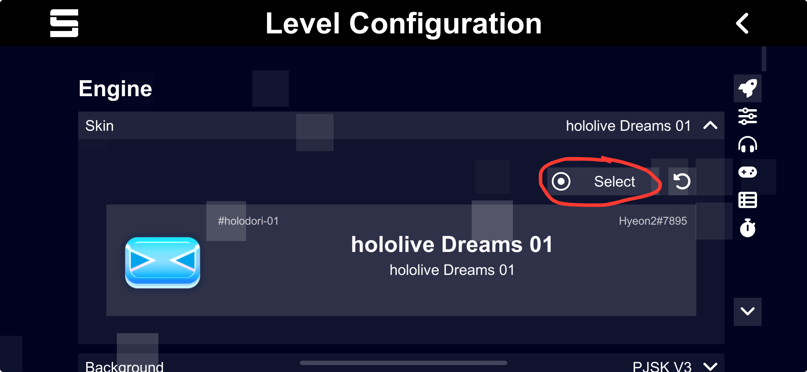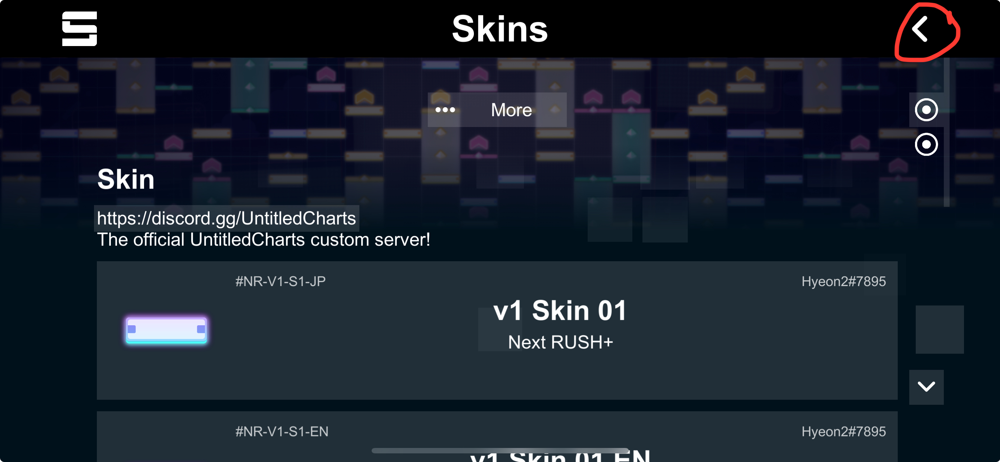<br>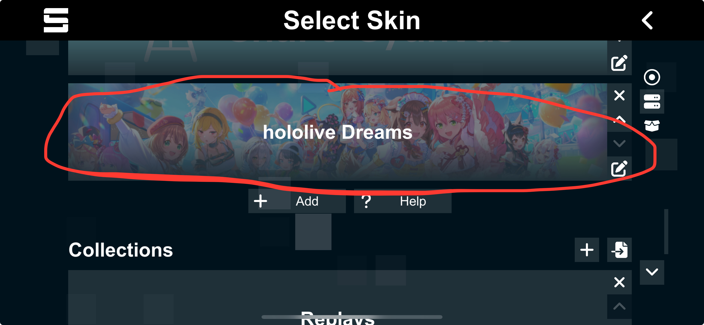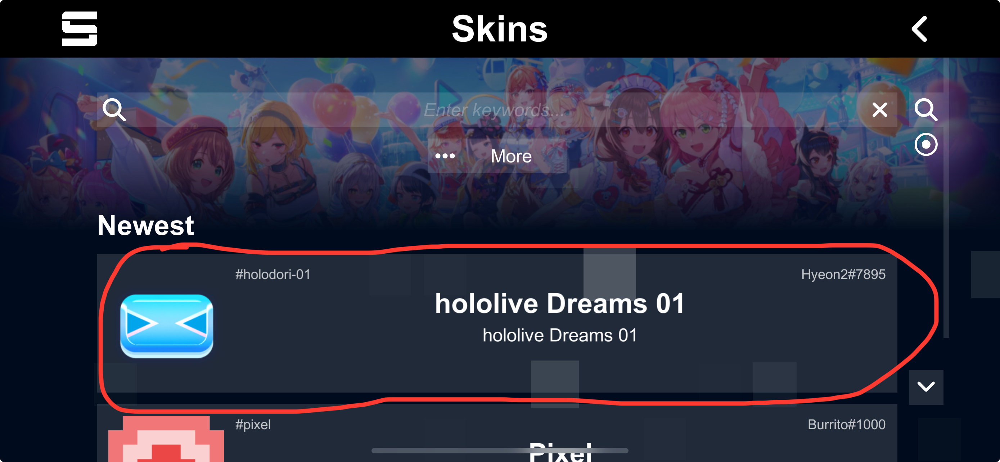

3. Screen record the video with **BLACK Background**, **`Stage` OFF**, **`Hide UI` ON or ALL**

> [!NOTE]
> To change the background, go to `Configuration > Background > Select`<br>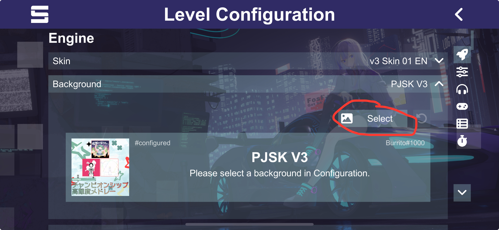

4. Transfer the video file to your computer.
5. Once done, refer to the usage guide below.

# Usage Guide
0. [Install AviUtl ExEdit2 in the Requirements section](#requirements)
1. Download the latest version of holodOverlay [here](https://github.com/TootieJin/holodOverlay/releases/latest/).
2. Unzip the file in a directory that **doesn't contain non-ASCII characters nor require administrative permissions** (see [here](https://github.com/TootieJin/pjsekai-overlay-APPEND/issues/5))
3. Open `holodOverlay.exe` to automatically download essential plugins. <u>You'll need to restart AviUtl ExEdit2 after this</u>.

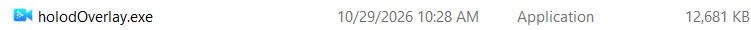<br>

4. In your `holodOverlay.exe` command prompt, input the chart ID including the prefix in the server list, and follow the instruction afterwards.
- **Server Lists**
  - **hololive Dreams**
    - <u>Official server(s):</u>
      - `holodori-`: hololive Dreams Unofficial Database ([sonolus.holodori.best](https://sonolus.holodori.best))
    - <u>Custom server(s):</u>
      - Oops. None yet!
  - **Project Sekai**
    - <u>Official server(s):</u>
      - `sekai-best-`: Sekai Viewer ([sonolus.sekai.best](https://sonolus.sekai.best))
      - `sss-`: Sbuga's Sonolus Server ([sonolus.sbuga.com](https://sonolus.sbuga.com))
    - <u>Custom server(s):</u>
      - `chcy-`: Chart Cyanvas
        - `0`: Archive ([cc.milkbun.org](https://cc.milkbun.org))
        - `1`: Offshoot server ([chart-cyanvas.com](https://chart-cyanvas.com))
      - `ptlv-`: Potato Leaves ([ptlv.milkbun.org](https://ptlv.milkbun.org))
      - <del>`utsk-`: Untitled Sekai ([us.pim4n-net.com](https://us.pim4n-net.com))</del>
      - `UnCh-`: UntitledCharts ([untitledcharts.com](https://untitledcharts.com))
    - <u>Local server(s):</u>
      - `sync-`: Local Server ([ScoreSync](https://github.com/Piliman22/ScoreSync) + [ScoreSync Modern](https://github.com/UntitledCharts/ScoreSync-Modern))
  - **Others**
    - `custom-[Chart ID]`: Custom Server (Source URL)

5. A new Explorer window will pop up with the chart ID folder in `./holodOverlay/dist/`. Opening that folder, you'll see something like this. Double-click the `.aup2` file to open a holodOverlay project in AviUtl ExEdit2.

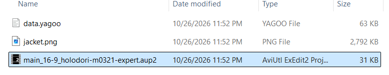<br>

6. Select a video and audio file in the timeline provided by aup2
  - Click `Video File`<br>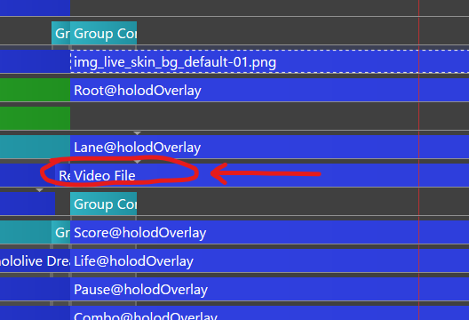
  - On the right of the screen, scroll down then click the `File` box<br>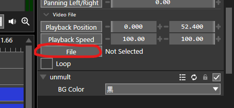

> [!WARNING]
> In this step, the video element in the _timeline_ uses [Unmult](https://github.com/mes51/AVIUtl2_Unmult), which converts all black (or white) pixels to transparent pixels for the accurate MV effect. **This is not the same as selecting "Blend Mode" as it does not produce the same effect!!**

7. Adjust the video & audio positioning as necessary.

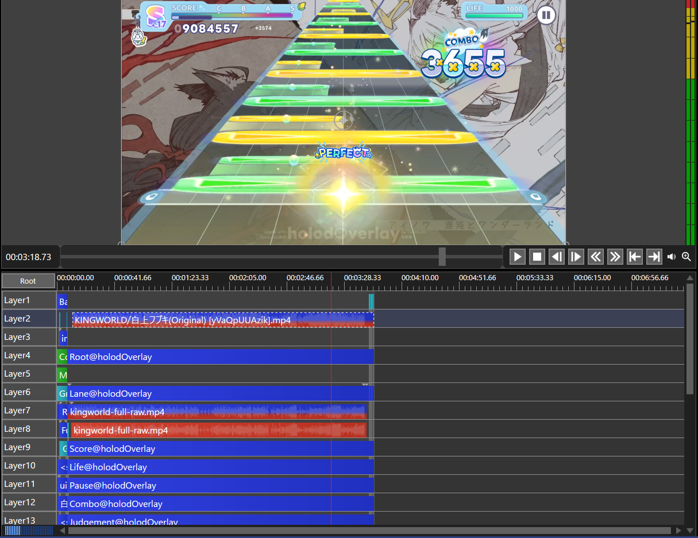

8. Go to `Root@holodOverlay` and adjust the `Offset`. **Make sure the first combo matches the first note hit in the video**

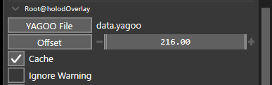

9. Once finished, export your video as mp4: `File > Export > MP4 Exporter (by えすご/Esugo)`

# Command-Line (Console) Usage
holodOverlay can be used in a command line for faster and direct usage. Open `cmd` or `powershell` in the `holodOverlay-{version}` folder and use:
```
./holodOverlay
```

## Configurations
```
holodOverlay [オプション (Options)] [譜面ID (Chart ID)]
```

```
Usage: holodOverlay [オプション (Options)] [譜面ID (Chart ID)]
  -difficulty string
        難易度を指定します。
        Specify the difficulty.
        [EASY, NORMAL, HARD, EXPERT, CREATE]
  -en-ui
        英語UIを使う。(Use English UI.)
  -ignore-dmg
        ダメージノーツを無視します。(Ignore damage notes.) (default true)
  -instance string
        サーバーインスタンス（またはソースURL）を指定します。
        Specify the server instance (or source URL).
  -no-explorer-auto-open
        出力先ディレクトリを自動で開くのを無効にします。(Disable auto-opening output directory in Explorer.)
  -out-dir string
        出力先ディレクトリを指定します。_chartId_ は譜面IDに置き換えられます。
        Enter the output path. _chartId_ will be replaced with the chart ID. (default "./dist/_chartId_")
  -skip-obj-install
        AviUtlオブジェクトのインストールをスキップします。(Skip installing AviUtl objects.)
  -skip-script-install
        AviUtlスクリプトのインストールをスキップします。(Skip installing AviUtl scripts.)
  -unit-score float
        ユニットスコアを指定します。(Specify the team's unit score.) (default 1e+06)
```

# UI Customization Specifications
Below will provide all adjustments you can make on all holodOverlay elements, along with <u>Custom Skins</u>.

> [!TIP]
> You can <u>save your configurations</u> by creating alias / saving alias as file (`.object`). Alias can then be drag-and-dropped into the timeline to insert holodOverlay elements with your configurations.\
> <u>**NOTE: Remember to change your `data.yagoo` when switching to other charts this way!**</u> <br><br>
> 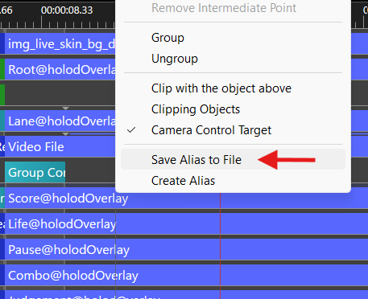

## Root@holodOverlay

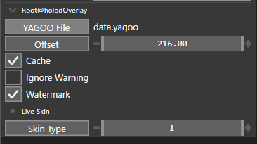

### General

| Name | Description | Default | Range |
| --- | --- | :---: | :---: |
| YAGOO File<br>`file` | Selects a `.yagoo` file to be used for parsing events Score, Combo, etc. | - | - |
| Offset<br>`track` | Number of frames to shift events<br>- Increase to shift timing later<br>- Decrease to shift timing earlier | 216.00 | -99999.99 ~ 99999.99 |
| Cache<br>`check` | Cache the data in the `data.yagoo` file. When cache is set to 0, any change in the `data.yagoo` is applied immediately | <input type="checkbox" disabled checked> ON | - |
| Ignore Warning<br>`check` | 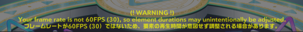<br>Disable showing the yellow warning text at the bottom of the preview<br><i>- These texts will not be rendered when exporting</i> | <input type="checkbox" disabled> OFF | - |
| Watermark<br>`check` | 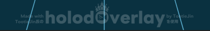<br>Toggle showing watermark at the bottom of the video | <input type="checkbox" disabled checked> ON | - |

### Live Skin

| Name | Description | Default | Range |
| --- | --- | :---: | :---: |
| Skin Type<br>`track` | 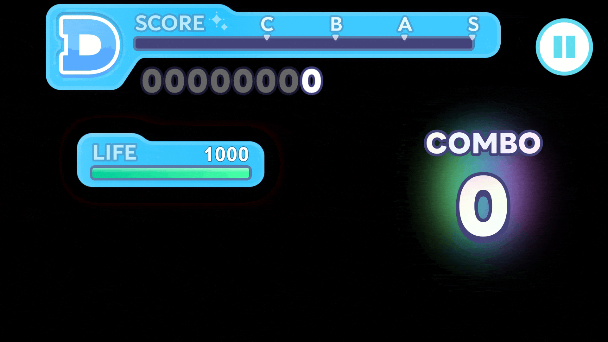<br>Select which skin type to use in the [Skin Type List.](#skin-type-list)<br><i>- This track bar will sync all elements that enabled the "Sync Skin Type to Root" option.</i> | 1 | 1 ~ 56 |

## Lane@holodOverlay

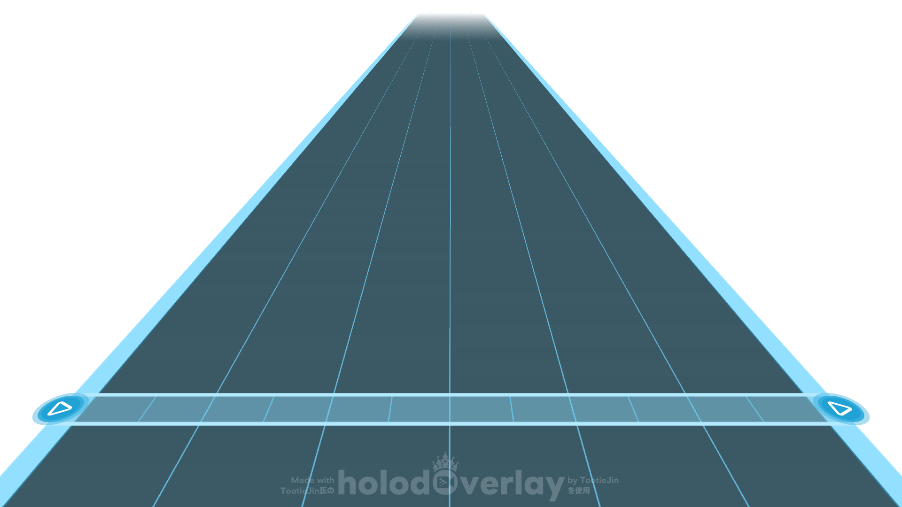

### General

| Name | Description | Default | Range |
| --- | --- | :---: | :---: |
| Dynamic Lane (Experimental)<br>`check` | Toggle the dynamic lane option<br><i>- You can disable this for the true default lane element.</i> | <input type="checkbox" disabled checked> ON | - |

### Lane
Options below will be shown if "Dynamic Lane (Experimental)" is enabled.

| Name | Description | Default | Range |
| --- | --- | :---: | :---: |
| Sync Skin Type to Root<br>`check` | Sync the skin type value from [Root@holodOverlay](#rootholodoverlay) | <input type="checkbox" disabled checked> ON | - |
| Skin Type<br>`track` | Select which skin type to use in the [Skin Type List.](#skin-type-list)<br><i>- This track bar is shown when "Sync Skin Type to Root" is disabled.</i> | 1 | 1 ~ 56 |
| Judgement Line Pos<br>`track` | Adjust the vertical position of the judgement line<br>- Increase to move up<br>- Decrease to move down | 0.00 | -1000.00 ~ 1000.00 |
| Left Lane<br>`track` | Adjust the left side of the lane. Each unit is the number of slots from the center<br><i>- This track bar is made in a way that dragging to the left (decreasing) moves the left lane to the left, and vice versa</i> | -6.00 | -48.00 ~ 48.00 |
| Right Lane<br>`track` | Adjust the right side of the lane. Each unit is the number of slots from the center<br><i>- This track bar is made in a way that dragging to the right (increasing) moves the right lane to the right, and vice versa</i> | 6.00 | -48.00 ~ 48.00 |

### Live Skin (Custom)
Options below will be shown if "Custom Skin" AND "Dynamic Lane (Experimental)" are enabled.

| Name | Description | Default |
| --- | --- | :---: |
| Color 1<br>`color` | Color outside the judgement line<br>- Example: `ff0000`<br>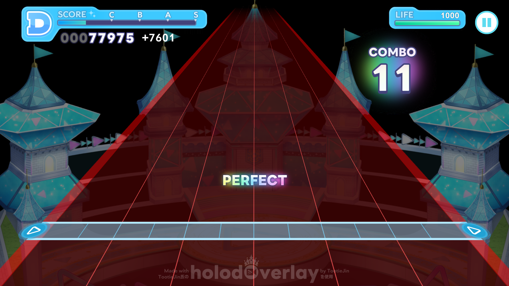 | `28c3ff` |
| Color 2<br>`color` | Judgement line color<br>- Example: `ff0000`<br>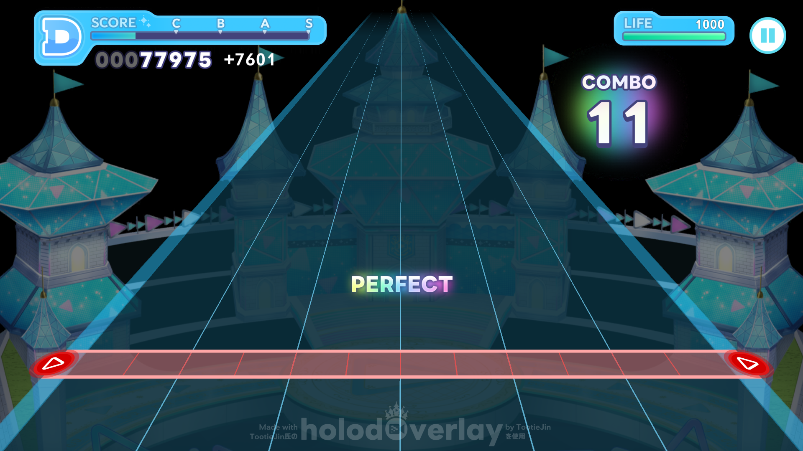 | `28c3ff` |
| Icon<br>`file` | Icon on the side of the judgement line<br>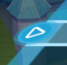 | - |

## Score@holodOverlay

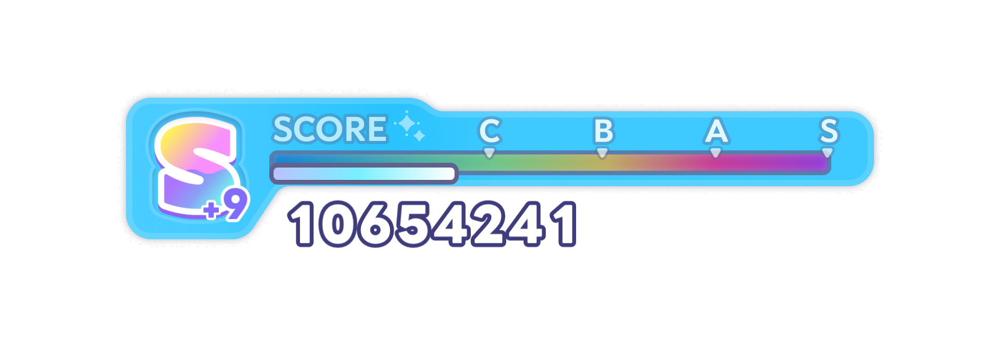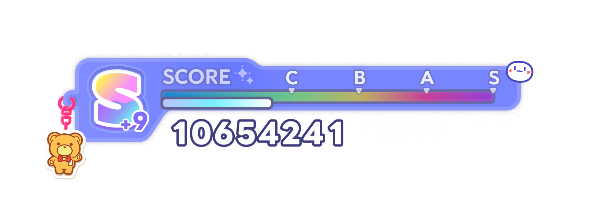

### General

| Name | Description | Default | Range |
| --- | --- | :---: | :---: |
| X-axis Boundary<br>`track` | Adjust the width of the drawing area in the element<br><i>- This track bar may be needed when you use very large numbers.</i> | 1920 | 0 ~ 9999 |
| Sync Skin Type to Root<br>`check` | Sync the skin type value from [Root@holodOverlay](#rootholodoverlay) | <input type="checkbox" disabled checked> ON | - |
| Skin Type<br>`track` | Select which skin type to use in the [Skin Type List.](#skin-type-list)<br><i>- This track bar is shown when "Sync Skin Type to Root" is disabled.</i> | 1 | 1 ~ 56 |
| Animation Speed<br>`value` | Adjust animation speed | 1.00 | - |
| Min Digit<br>`track` | Render the minimum amount of digits in score | 8 | 1 ~ 99 |
| Display beyond Rank S+9<br>`check` | Show ranks beyond S+9 | <input type="checkbox" disabled> OFF | - |
| Add "+" to other ranks<br>`check` | Show ranks the same way as Unit Score (D+, C+, B+, A+) | <input type="checkbox" disabled> OFF | - |

### Live Skin (Custom)
Options below will be shown if "Custom Skin" is enabled.

| Name | Description | Default |
| --- | --- | :---: |
| Score Color<br>`color` | Color of the base in Score | `28c3ff` |
| Font 1<br>`font` | Font for Total Score and Plus<br>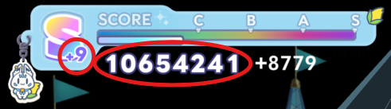 | `LINE Seed Sans App ExtraBold` |
| Font 2<br>`font` | Font for Added Score<br>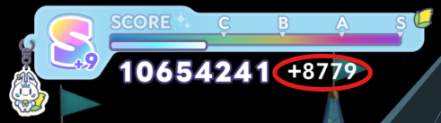 | `TT-Ro GSan Serif StdN B` |

**Skin Decoration**

| Name | Description | Default |
| --- | --- | :---: |
| Keychain<br>`file` | 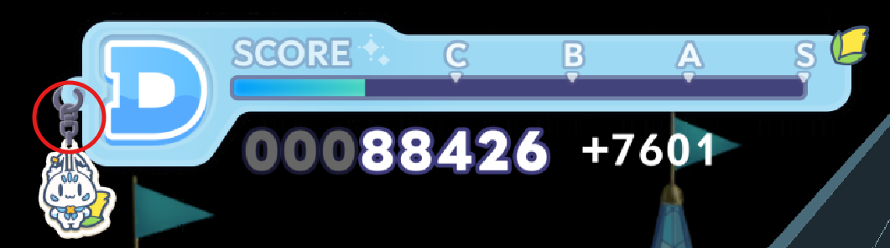 | - |
| Acrylic Piece<br>`file` | 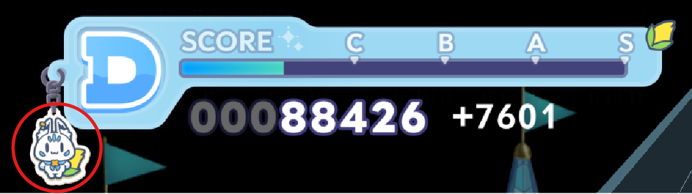 | - |
| Sticker<br>`file` | 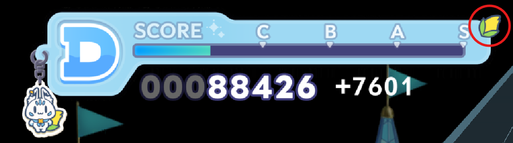 | - |

## Life@holodOverlay


### General

| Name | Description | Default | Range |
| --- | --- | :---: | :---: |
| Sync Skin Type to Root<br>`check` | Sync the skin type value from [Root@holodOverlay](#rootholodoverlay) | <input type="checkbox" disabled checked> ON | - |
| Skin Type<br>`track` | Select which skin type to use in the [Skin Type List.](#skin-type-list)<br><i>- This track bar is shown when "Sync Skin Type to Root" is disabled.</i> | 1 | 1 ~ 56 |
| Animation Speed<br>`value` | Adjust animation speed | 1.00 | - |
| Max LIFE<br>`track` | Amount of LIFE for the bar to be completely filled | 1000 | 1 ~ 99999 |
| LIFE Value<br>`text` | 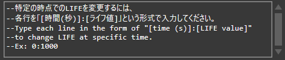 | - | - |

### Live Skin (Custom)
Options below will be shown if "Custom Skin" is enabled.

| Name | Description | Default |
| --- | --- | :---: |
| Life Color<br>`color` | Color of the base in LIFE | `28c3ff` |
| Font<br>`font` | Font for LIFE<br>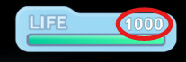 | `TT-Ro GSan Serif StdN B` |

## Pause@holodOverlay


### General

| Name | Description | Default | Range |
| --- | --- | :---: | :---: |
| Sync Skin Type to Root<br>`check` | Sync the skin type value from [Root@holodOverlay](#rootholodoverlay) | <input type="checkbox" disabled checked> ON | - |
| Skin Type<br>`track` | Select which skin type to use in the [Skin Type List.](#skin-type-list)<br><i>- This track bar is shown when "Sync Skin Type to Root" is disabled.</i> | 1 | 1 ~ 56 |
| Disable Pause<br>`check` | Make the pause button turn gray | <input type="checkbox" disabled> OFF | - |

### Live Skin (Custom)
Options below will be shown if "Custom Skin" is enabled.

| Name | Description | Default |
| --- | --- | :---: |
| Pause Color<br>`color` | Color of the base in Pause | `5fdcf0` |

## Combo@holodOverlay

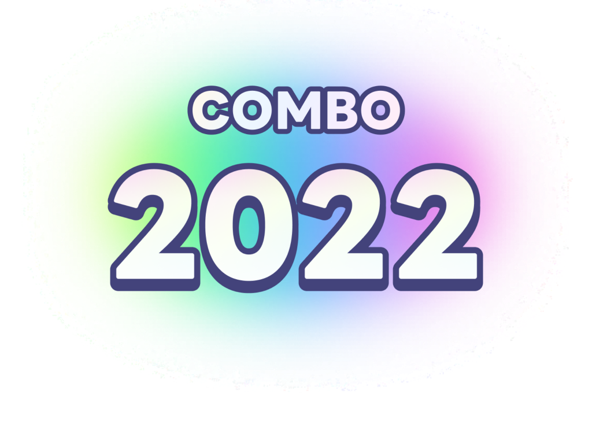

### General

| Name | Description | Default | Range |
| --- | --- | :---: | :---: |
| X-axis Boundary<br>`track` | Adjust the width of the drawing area in the element<br><i>- This track bar may be needed when you use very large numbers.</i> | 1024 | 0 ~ 9999 |
| Sync Skin Type to Root<br>`check` | Sync the skin type value from [Root@holodOverlay](#rootholodoverlay) | <input type="checkbox" disabled checked> ON | - |
| Skin Type<br>`track` | Select which skin type to use in the [Skin Type List.](#skin-type-list)<br><i>- This track bar is shown when "Sync Skin Type to Root" is disabled.</i> | 1 | 1 ~ 56 |
| Animation Speed<br>`value` | Adjust animation speed | 1.00 | - |
| AP/FC<br>`track` | Adjust which clear type to show in the combo background<br>`0` = OFF, `1` = FC, `2` = AP | 2 | 0 ~ 2 |
| Show 0 Combo<br>`check` | Toggle showing the 0th combo before the first event | <input type="checkbox" disabled> OFF | - |

### Live Skin (Custom)
Options below will be shown if "Custom Skin" is enabled.

| Name | Description | Default |
| --- | --- | :---: |
| Digit 0 ~ 9<br>`file` | 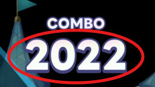 | - |
| Combo Label<br>`file` | 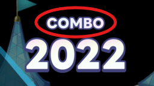 | - |

## Judgement@holodOverlay

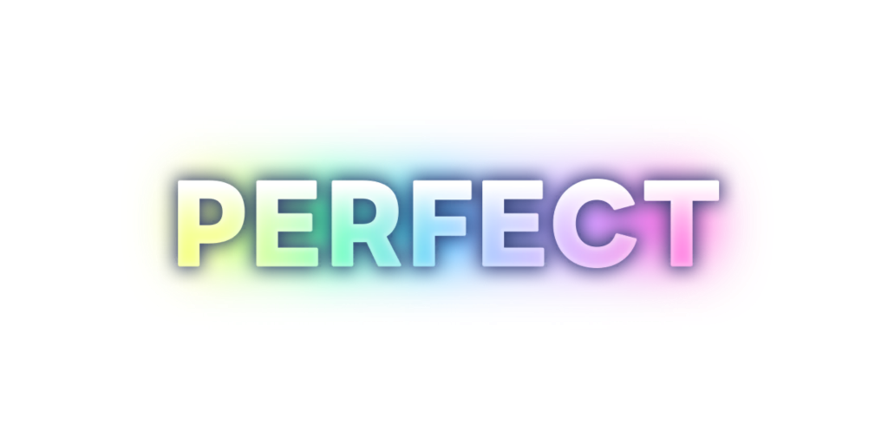

### General

| Name | Description | Default | Range |
| --- | --- | :---: | :---: |
| X-axis Boundary<br>`track` | Adjust the width of the drawing area in the element<br><i>- This track bar may be needed when you use very large numbers.</i> | 1024 | 0 ~ 9999 |
| Sync Skin Type to Root<br>`check` | Sync the skin type value from [Root@holodOverlay](#rootholodoverlay) | <input type="checkbox" disabled checked> ON | - |
| Skin Type<br>`track` | Select which skin type to use in the [Skin Type List.](#skin-type-list)<br><i>- This track bar is shown when "Sync Skin Type to Root" is disabled.</i> | 1 | 1 ~ 56 |
| Animation Speed<br>`value` | Adjust animation speed | 1.00 | - |
| Judge Type<br>`track` | Adjust which judge type to show | 1 | 1 ~ 6 |
| Show Judge Indefinitely<br>`check` | Toggle showing the judge that remains visible throughout the event | <input type="checkbox" disabled> OFF | - |

### Live Skin (Custom)
Options below will be shown if "Custom Skin" is enabled.

| Name | Description | Default |
| --- | --- | :---: |
| Judge 1<br>`file` | 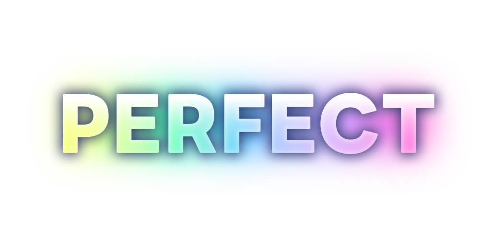 | - |
| Judge 2<br>`file` |  | - |
| Judge 3<br>`file` |  | - |
| Judge 4<br>`file` |  | - |
| Judge 5<br>`file` |  | - |
| Judge 6<br>`file` |  | - |

# Extras

## Skin Type List
Below lists all holomem skins configurations in order.

```lua
Code = { -- internal ID, score, life, pause, score decoration
  "default-01", 0x28c3ff, 0x28c3ff, 0x5fdcf0, 0, -- 1. Default
  "00001", 0x6878ff, 0x6878ff, 0xfd368a, 1,      -- 2. Tokina Sora
  "00002", 0xff6187, 0xff6187, 0xfd91b7, 1,      -- 3. Robocosan
  "00004", 0xabe64d, 0xabe64d, 0xff4991, 1,      -- 4. AZKi
  "00005", 0xe5395b, 0xe5395b, 0x0046b3, 1,      -- 5. Sakura Miko
  "00006", 0x93d5f2, 0x93d5f2, 0x65637f, 1,      -- 6. Hoshimachi Suisei
  "00007", 0xffcb30, 0xffcb30, 0x8dd600, 1,      -- 7. Aki Rosenthal
  "00010", 0xdd305b, 0xdd305b, 0x8a6f72, 1,      -- 8. Akai Haato
  "00011", 0xff5487, 0xff5487, 0xff85bc, 1,      -- 9. Shirakami Fubuki
  "00012", 0xe5ce00, 0xe5ce00, 0x5cd0dc, 1,      -- 10. Natsuiro Matsuri
  "00013", 0xf081a3, 0xf081a3, 0x634c59, 1,      -- 11. Nakiri Ayame
  "00014", 0xdb3131, 0xdb3131, 0x575769, 1,      -- 12. Yuzuki Choco
  "00015", 0xff909e, 0xff909e, 0xdd3654, 1,      -- 13. Oozora Subaru
  "00016", 0xd866ed, 0xd866ed, 0x9a70f3, 1,      -- 14. Ookami Mio
  "00017", 0xffcd28, 0xffcd28, 0xff637c, 1,      -- 15. Nekomata Okayu
  "00018", 0x75c0ff, 0x75c0ff, 0x2b2d80, 1,      -- 16. Inugami Korone
  "00019", 0x57a9ff, 0x57a9ff, 0x97daef, 1,      -- 17. Usada Pekora
  "00021", 0xffab2d, 0xffab2d, 0x4ab0e9, 1,      -- 18. Shiranui Flare
  "00022", 0xa5b5b7, 0xa5b5b7, 0x4f6e8f, 1,      -- 19. Shirogane Noel
  "00023", 0xc2153b, 0xc2153b, 0x453748, 1,      -- 20. Houshou Marine
  "00026", 0xe2d065, 0xe2d065, 0xff8f96, 1,      -- 21. Tsunomaki Watame
  "00027", 0xb77fff, 0xb77fff, 0xfc96dc, 1,      -- 22. Tokoyami Towa
  "00028", 0xff93d0, 0xff93d0, 0x99c6ff, 1,      -- 23. Himemori Luna
  "00030", 0x49aaff, 0x49aaff, 0x5cceff, 1,      -- 24. Yukihana Lamy
  "00031", 0xffc633, 0xffc633, 0xff852d, 1,      -- 25. Momosuzu Nene
  "00032", 0x757575, 0x757575, 0x91c1b1, 1,      -- 26. Shishiro Botan
  "00034", 0xed0043, 0xed0043, 0x0083eb, 1,      -- 27. Omaru Polka
  "00035", 0x9464d2, 0x9464d2, 0x493a58, 1,      -- 28. La+ Darknesss
  "00036", 0x831550, 0x831550, 0x41282e, 1,      -- 29. Takane Lui
  "00037", 0xff95c8, 0xff95c8, 0x52dfce, 1,      -- 30. Hakui Koyori
  "00039", 0x5ecfc8, 0x5ecfc8, 0xd5c293, 1,      -- 31. Kazama Iroha
  "03001", 0xffaaaa, 0xffaaaa, 0x9f7060, 1,      -- 32. Ayunda Risu
  "03002", 0xaa83ff, 0xaa83ff, 0xfad443, 1,      -- 33. Moona Hoshinova
  "03003", 0x9cdf36, 0x9cdf36, 0xfda2bb, 1,      -- 34. Airani Iofifteen
  "03004", 0xc40041, 0xc40041, 0x394452, 1,      -- 35. Kureiji Ollie
  "03005", 0xf3bf41, 0xf3bf41, 0xb3906f, 1,      -- 36. Anya Melfissa
  "03006", 0x004dc2, 0x004dc2, 0x5ac6b6, 1,      -- 37. Pavolia Reine
  "03007", 0x9290a1, 0x9290a1, 0x7e95ed, 1,      -- 38. Vestia Zeta
  "03008", 0xfc4045, 0xfc4045, 0x54291a, 1,      -- 39. Kaela Kovalskia
  "03009", 0x50cfe1, 0x50cfe1, 0x63668e, 1,      -- 40. Kobo Kanaeru
  "04001", 0xe01c61, 0xe01c61, 0xff8eb8, 1,      -- 41. Mori Calliope
  "04002", 0xff792e, 0xff792e, 0x38d2a8, 1,      -- 42. Takanashi Kiara
  "04003", 0x5d4e83, 0x5d4e83, 0xff8d35, 1,      -- 43. Ninomae Ina'nis
  "04007", 0xdf185d, 0xdf185d, 0x60ced0, 1,      -- 44. IRyS
  "04010", 0x2221aa, 0x2221aa, 0xdcb33e, 1,      -- 45. Ouro Kronii
  "04012", 0xee2222, 0xee2222, 0x48d5c8, 1,      -- 46. Hakos Baelz
  "04013", 0xc288f7, 0xc288f7, 0x44445d, 1,      -- 47. Shiori Novella
  "04014", 0x8674ff, 0x8674ff, 0xffa7ca, 1,      -- 48. Koseki Bijou
  "04015", 0x3950ee, 0x3950ee, 0x3f3d53, 1,      -- 49. Nerissa Ravencroft
  "04016", 0x67b2ff, 0x67b2ff, 0xf7a6ca, 1,      -- 50. Fuwawa Abyssgard*
  "04017", 0xf7a6ca, 0xf7a6ca, 0x67b2ff, 1,      -- 51. Mococo Abyssgard*
  "06002", 0xffd380, 0xffd380, 0xfc8275, 1,      -- 52. Otonose Kanade
  "06003", 0xff77a9, 0xff77a9, 0x9d8dff, 1,      -- 53. Ichijou Ririka
  "06004", 0x357b6c, 0x357b6c, 0xd7845a, 1,      -- 54. Juufuutei Raden
  "06005", 0xa4aaff, 0xa4aaff, 0xdec2a7, 1,      -- 55. Todoroki Hajime
  "80001", 0x67b2ff, 0xf7a6ca, 0x67b2ff, 1,      -- 56. FUWAMOCO
} -- *No Live Skin in-game, but technically supported
```