## 必須事項
- [AviUtl ExEdit2 **（インストーラ版）**](http://spring-fragrance.mints.ne.jp/aviutl/) *（AviUtl ExEdit2をインストールしたら、`holodOverlay.exe` を起動して、必要なプラグインを自動的にダウンロードしてください。その後、AviUtl ExEdit2を再起動する必要があります。）* 
- **[PowerShell](https://github.com/PowerShell/PowerShell)**
- システムロケールは **必ず「日本語（日本）」** に設定してください （holodOverlayで設定することもできますが、[こちら](https://github.com/TootieJin/pjsekai-overlay-APPEND/wiki/Start-Here!#changing-system-locale)にアクセスして、ご自身で調整することも可能です。）
- AviUtl ExEdit2の基本的な知識
  - 日本語版の動画ガイドプレイリストは[こちら](https://www.youtube.com/playlist?list=PLjvcc2yii9PIr27ZsMzKymY2qST3GFF_M)（推奨）。
  - 「AviUtl2これだけはやっておけ集」をまとたNote記事は[こちら](https://note.com/hikami_meruru/n/na72411631b95)（2026年版、日本語・英語対応）。
  - 英語版の動画ガイドプレイリストは[こちら](https://www.youtube.com/playlist?list=PLKIaXWZCUwrvfr3WNG9P81aVvuCHRJXUZ)。
  - AviUtl ExEdit2の簡易説明（ドキュメント）は[こちら](https://docs.aviutl2.jp/usage)。

> [!CAUTION]
> [pjsekai-overlay-APPEND](https://github.com/TootieJin/pjsekai-overlay-APPEND)とは異なり、本ツールはAviUtl（旧バージョン）には対応していません。

# 動画の作り方
**黒い背景で、すべてのUI（レーンを含む）が非表示になっているクリーンな録画**が必要です。下記スクリーンショットのように：

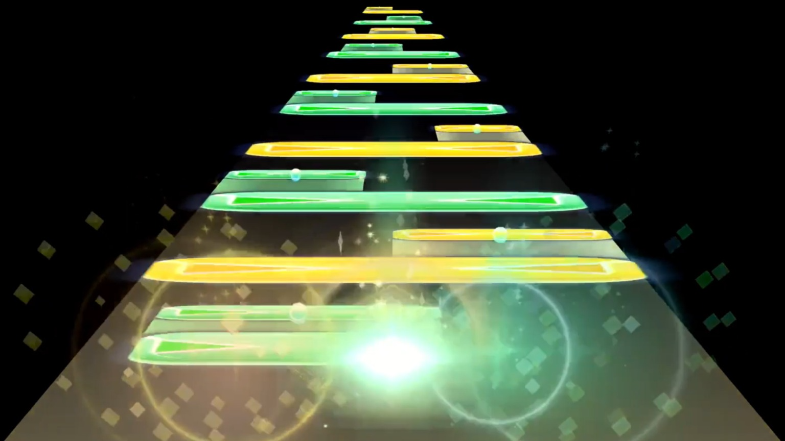<br>

## Sonolus
<br>

以下の手順に従ってください：

0. <u>(カスタムホロドリサーバーを使用して記録していない場合)</u> [Sonolus](https://sonolus.com/)のカスタムサーバーリストに `sonolus.holodori.best` を追加してください。
1. [Sonolus](https://sonolus.com/)で譜面を撮影する
2. <u>(カスタムホロドリサーバーを使用して録画していない場合)</u> スキンとSFXを、`sonolus.holodori.best`サーバーが提供するものに変更してください

> [!NOTE]
> ホロドリのスキン/SFXに変更するには、`設定 > スキン > 選択`に移動し、一度戻ります（これにより、スキン/SFXを選択するサーバーの画面に移動します）。その後、hololive Dreams（`sonolus.holodori.best`）に移動し、そこからスキン/SFXを変更してください。<br>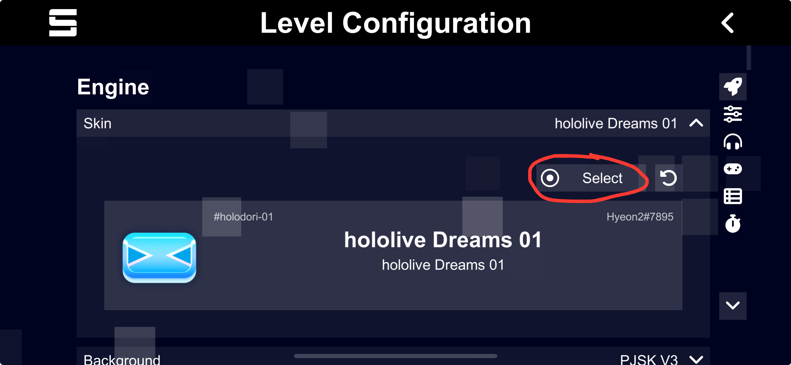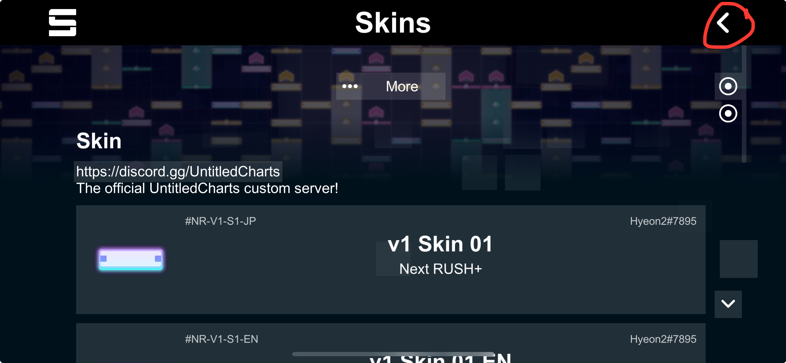<br>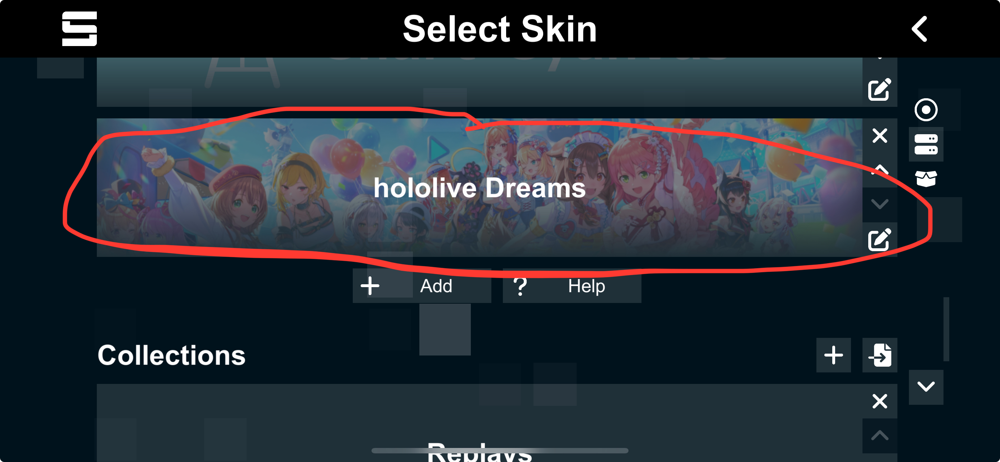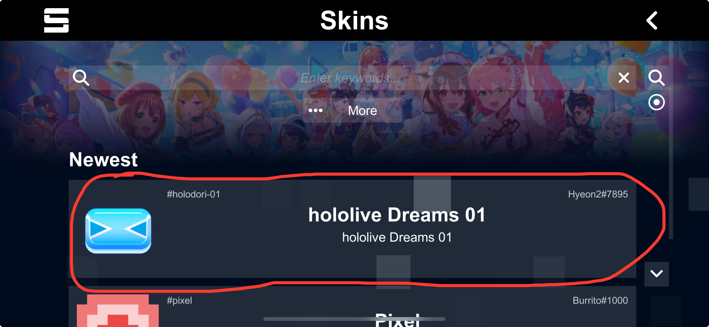

3. **背景を黒**にし、**`Stage` OFF**、**`Hide UI` ONかALL** にして、動画をスクリーン録画します。

> [!NOTE]
> 背景を変更するには、`設定 > 背景 > 選択` に移動してください<br>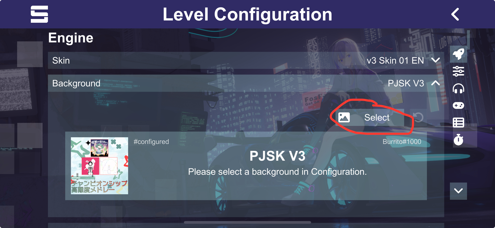

4. 撮影したプレイ動画のファイルをパソコンに転送する
5. 下の利用方法に従ってUIを後付けする

# 利用方法
0. [「必要環境」セクションにAviUtl ExEdit2をインストールしてください](#必須事項)
1. 右のReleasesから最新のバージョンのzipを[ダウンロード](https://github.com/TootieJin/holodOverlay/releases/latest/)する
2. **非ASCII文字が含まれておらず、かつ管理者権限を必要としない**ディレクトリにファイルを解凍してください。（[こちら](https://github.com/TootieJin/pjsekai-overlay-APPEND/issues/5)を参照）
3. `holodOverlay.exe` を開くと、必要なプラグインが自動的にダウンロードされます。<u>その後、AviUtl ExEdit2 を再起動する必要があります</u>。

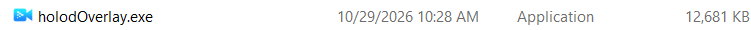<br>

4. `holodOverlay.exe` のコマンドプロンプトで、サーバーリストにあるプレフィックスを含む譜面IDを入力し、その後の指示に従ってください。
- **サーバー一覧**
  - **ホロドリ**
    - <u>公式サーバー：</u>
      - `holodori-`: hololive Dreams 非公式データベース ([sonolus.holodori.best](https://sonolus.holodori.best))
    - <u>カスタムサーバー：</u>
      - おっと、まだないですね！
  - **プロセカ**
    - <u>公式サーバー：</u>
      - `sekai-best-`: Sekai Viewer ([sonolus.sekai.best](https://sonolus.sekai.best))
      - `sss-`: SbugaのSonolusサーバー ([sonolus.sbuga.com](https://sonolus.sbuga.com))
    - <u>カスタムサーバー：</u>
      - `chcy-`: Chart Cyanvas
        - `0`: アーカイブ ([cc.milkbun.org](https://cc.milkbun.org))
        - `1`: 分岐サーバー ([chart-cyanvas.com](https://chart-cyanvas.com))
      - `ptlv-`: Potato Leaves ([ptlv.milkbun.org](https://ptlv.milkbun.org))
      - <del>`utsk-`: Untitled Sekai ([us.pim4n-net.com](https://us.pim4n-net.com))</del>
      - `UnCh-`: UntitledCharts ([untitledcharts.com](https://untitledcharts.com))
    - <u>ローカルサーバー：</u>
      - `sync-`: Local Server ([ScoreSync](https://github.com/Piliman22/ScoreSync) + [ScoreSync Modern](https://github.com/UntitledCharts/ScoreSync-Modern))
  - **その他**
    - `custom-[譜面ID]`: カスタムサーバー（ソースURL）

5. `./holodOverlay/dist/` にある譜面IDフォルダが表示された新しいExplorerウィンドウがポップアップ表示されます。そのフォルダを開くと、次のような画面が表示されます。`.aup2` ファイルをダブルクリックすると、AviUtl ExEdit2でholodOverlayプロジェクトが開きます。

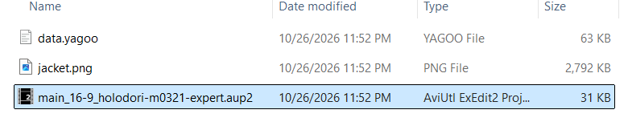<br>

6. aup2が提供するタイムライン上で、動画ファイルと音声ファイルを選択してください
  - `動画ファイル`をクリック<br>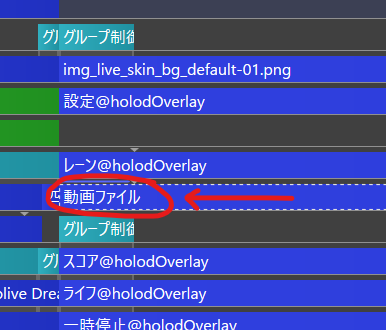
  - 画面の右側で、下にスクロールしてから`ファイル`ボックスをクリック<br>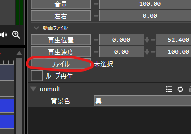

> [!WARNING]
> この手順では、*タイムライン*内の動画要素に[Unmult](https://github.com/mes51/AVIUtl2_Unmult)を使用します。これにより、すべての黒（または白）ピクセルが透明ピクセルに変換され、正確なMV効果が得られます。**これは「合成モード」を選択することとは異なり、同じ効果は得られません！！**

7. 必要に応じて動画と音声の位置を調整してください。

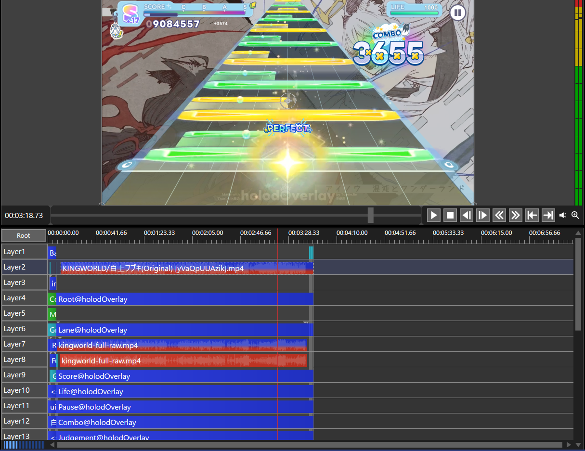

8. `設定@holodOverlay` に移動し、`オフセット` を調整してください。**最初のコンボが、動画内で最初にヒットするノートと一致していることを確認してください**

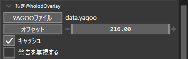

9. 完了後、動画をmp4形式で出力します：`ファイル > ファイル出力 > MP4 Exporter (by えすご/Esugo)`

# コマンドライン（コンソール）での使用方法
holodOverlayは、コマンドラインから実行することで、より迅速かつ直接的に利用できます。`/holodOverlay-{version}` フォルダ内で `cmd` または `powershell` を起動し、以下のコマンドを実行してください：
```
./holodOverlay
```

## 構成
```
holodOverlay [オプション (Options)] [譜面ID (Chart ID)]
```

```
Usage: holodOverlay [オプション (Options)] [譜面ID (Chart ID)]
  -difficulty string
        難易度を指定します。
        Specify the difficulty.
        [EASY, NORMAL, HARD, EXPERT, CREATE]
  -en-ui
        英語UIを使う。(Use English UI.)
  -ignore-dmg
        ダメージノーツを無視します。(Ignore damage notes.) (default true)
  -instance string
        サーバーインスタンス（またはソースURL）を指定します。
        Specify the server instance (or source URL).
  -no-explorer-auto-open
        出力先ディレクトリを自動で開くのを無効にします。(Disable auto-opening output directory in Explorer.)
  -out-dir string
        出力先ディレクトリを指定します。_chartId_ は譜面IDに置き換えられます。
        Enter the output path. _chartId_ will be replaced with the chart ID. (default "./dist/_chartId_")
  -skip-obj-install
        AviUtlオブジェクトのインストールをスキップします。(Skip installing AviUtl objects.)
  -skip-script-install
        AviUtlスクリプトのインストールをスキップします。(Skip installing AviUtl scripts.)
  -unit-score float
        ユニットスコアを指定します。(Specify the team's unit score.) (default 1e+06)
```

# UIカスタマイズ仕様書
以下では、すべてのholodOverlay要素に対して行えるすべての調整と、<u>カスタムスキン</u>について説明します。

> [!TIP]
> <u>設定を保存</u>するには、エイリアスを作成するか、エイリアスをファイル（`.object`）として保存します。その後、エイリアスをタイムラインにドラッグ＆ドロップすることで、その設定が反映されたholodOverlay要素を挿入できます。<br>
> <u>**注意：この方法で他のチャートに切り替える際は、`data.yagoo`を変更することを忘れないでください！**</u> <br><br>
> 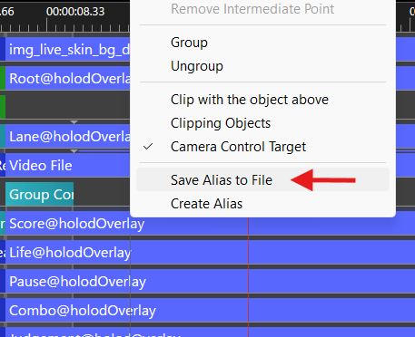

## 設定@holodOverlay

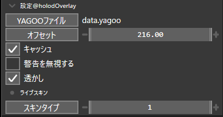

### 概要

| 名前 | 説明 | デフォルト | 範囲 |
| --- | --- | :---: | :---: |
| YAGOOファイル<br>`file` | イベント（スコア、コンボなど）の解析に使用する `.yagoo` ファイルを選択する | - | - |
| オフセット<br>`track` | タイミングをシフトするフレーム数<br>- 増加するとタイミングが遅くなる<br>- 減少するとタイミングが早くなる | 216.00 | -99999.99 ~ 99999.99 |
| キャッシュ<br>`check` | データを`data.yagoo`にキャッシュします。キャッシュが0に設定されている場合、`data.yagoo`の変更は即時反映されます | ON | - |
| 警告を無視する<br>`check` | <br>プレビューの下部に表示される黄色の警告テキストを非表示にする<br><i>- エクスポート時には、これらのテキストは表示されません</i> | OFF | - |
| 透かし<br>`check` | 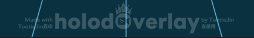<br>動画の下部に表示される透かしの表示/非表示を切り替える | ON | - |

### ライブスキン

| 名前 | 説明 | デフォルト | 範囲 |
| --- | --- | :---: | :---: |
|スキンタイプ<br>`track` | 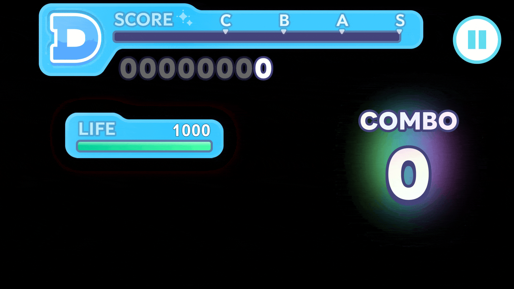<br>[スキンタイプ一覧](#スキンタイプ一覧)で、使用するスキンタイプを選択する<br><i>- このトラックバーは、「スキンタイプを設定に同期」オプションが有効になっているすべての要素を同期します。</i> | 1 | 1 ~ 56 |

## レーン@holodOverlay

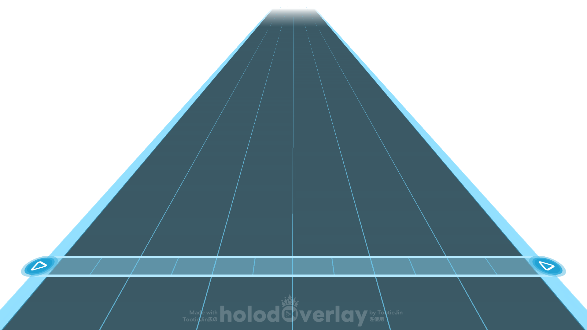

### 概要

| 名前 | 説明 | デフォルト | 範囲 |
| --- | --- | :---: | :---: |
| 動的レーン (実験的機能)<br>`check` | 動的レーンオプションを切り替える<br><i>- 真のデフォルトレーン要素については、これを無効にすることができます。</i> | ON | - |

### レーン
「動的レーン (実験的機能)」が有効になっている場合、以下のオプションが表示されます。

| 名前 | 説明 | デフォルト | 範囲 |
| --- | --- | :---: | :---: |
| スキンタイプを設定に同期<br>`check` | [設定@holodOverlay](#設定holodoverlay)からスキンタイプの値を同期する | ON | - |
| スキンタイプ<br>`track` | [スキンタイプ一覧](#スキンタイプ一覧)で、使用するスキンタイプを選択する<br><i>- このトラックバーは、「スキンタイプを設定に同期」が無効になっている場合に表示されます。</i> | 1 | 1 ~ 56 |
| 判定ラインの位置<br>`track` | 判定ラインの垂直位置を調整する<br>- 数値を大きくすると上に移動します<br>- 数値を小さくすると下に移動します | 0.00 | -1000.00 ~ 1000.00 |
| 左レーン<br>`track` | レーンの左側を調整します。各単位は、中心からのスロット数です<br><i>- このトラックバーは、左にドラッグ（値を小さくする）と左側のレーンが左に移動し、その逆も同様になるよう設計されています</i> | -6.00 | -48.00 ~ 48.00 |
| 右レーン<br>`track` | レーンの右側を調整します。各単位は、中心からのスロット数です<br><i>- このトラックバーは、右にドラッグ（値を大きく）すると右側のレーンが右に移動し、その逆も同様になるよう設計されています</i> | 6.00 | -48.00 ~ 48.00 |
| 背景の透明度<br>`track` | レーンの背景の透明度を調整する<br>値が大きいほど、背景は目立たなくなります | 20.00 | 0 ~ 100 |
| 部門ごとのレーン数<br>`track` | 車線数に応じて区画の輪郭線を描く<br>`0` = OFF | 2 | 0 ~ 96 |

### ライブスキン（カスタム）
「カスタムスキン」と「動的レーン (実験的機能)」の両方が有効になっている場合、以下のオプションが表示されます。

| 名前 | 説明 | デフォルト |
| --- | --- | :---: |
| 色1<br>`color` | 判定ラインの外側を塗る<br>- 例： `ff0000`<br>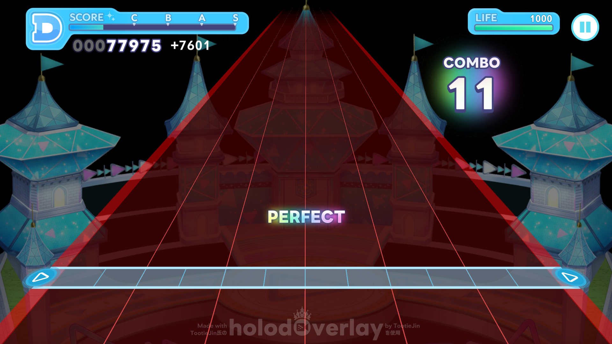 | `28c3ff` |
| 色2<br>`color` | 判定ラインの色<br>- 例： `ff0000`<br>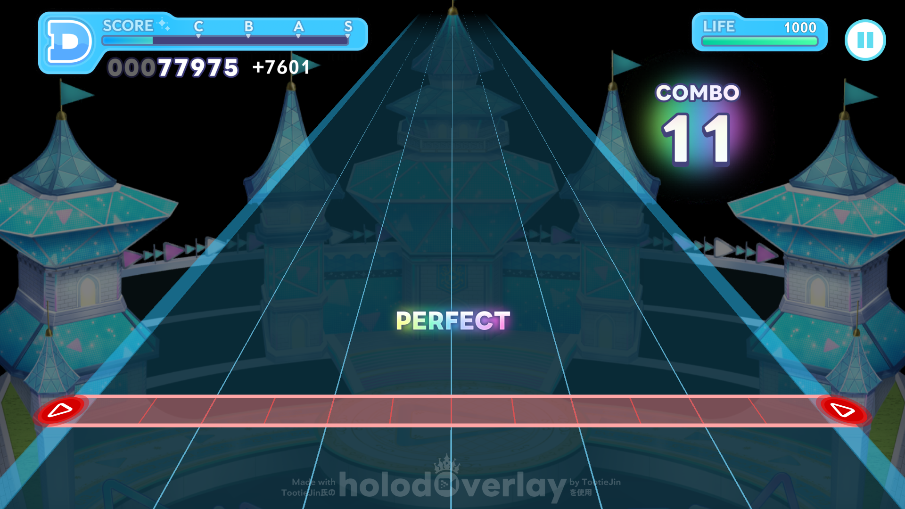 | `28c3ff` |
| アイコン<br>`file` | 判定ラインの横にあるアイコン<br>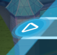 | - |

## スコア@holodOverlay

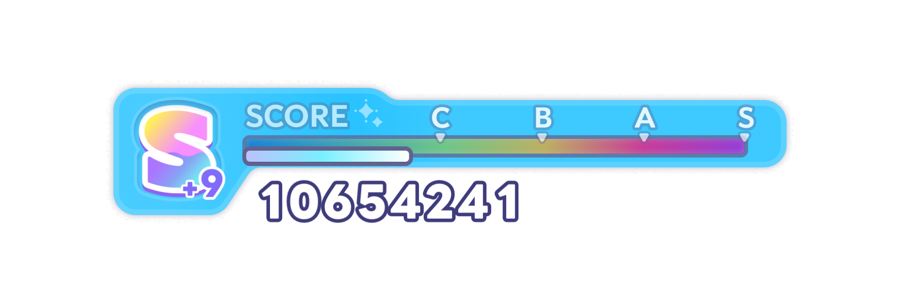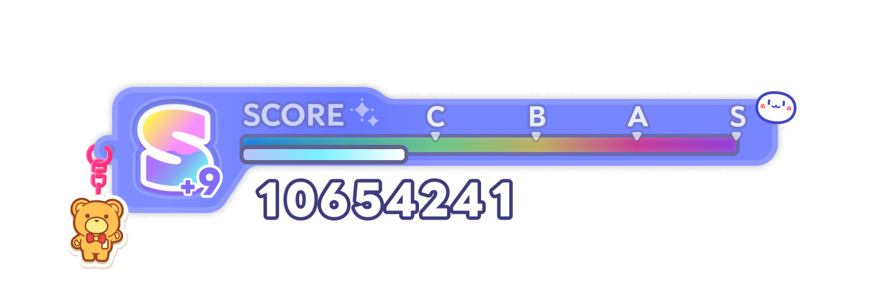

### 概要

| 名前 | 説明 | デフォルト | 範囲 |
| --- | --- | :---: | :---: |
| X軸境界<br>`track` | 要素内の描画領域の幅を調整する<br><i>- 非常に大きな数値を使用する場合、このトラックバーが必要になることがあります。</i> | 1920 | 0 ~ 9999 |
| スキンタイプを設定に同期<br>`check` | [設定@holodOverlay](#設定holodoverlay)からスキンタイプの値を同期する | ON | - |
| スキンタイプ<br>`track` | [スキンタイプ一覧](#スキンタイプ一覧)で、使用するスキンタイプを選択する<br><i>- このトラックバーは、「スキンタイプを設定に同期」が無効になっている場合に表示されます。</i> | 1 | 1 ~ 56 |
| アニメーション速度<br>`value` | アニメーション速度を調整する | 1.00 | - |
| 最小桁数<br>`track` | スコアの桁数を最小限に表示する | 8 | 1 ~ 99 |
| ランクS+9を超える<br>`check` | S+9以上のランクを表示する | OFF | - |
| 他のランクに「+」を追加する<br>`check` | ランクは「ユニットスコア」（D+、C+、B+、A+）と同じ方式で表示する | OFF | - |

### ライブスキン（カスタム）
「カスタムスキン」が有効になっている場合、以下のオプションが表示されます。

| 名前 | 説明 | デフォルト |
| --- | --- | :---: |
| スコアの色<br>`color` | スコアにおけるベースの色 | `28c3ff` |
| フォント1<br>`font` | 総合スコアと「+」のフォント<br>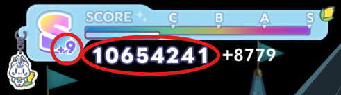 | `LINE Seed Sans App ExtraBold` |
| フォント2<br>`font` | 追加スコアのフォント<br>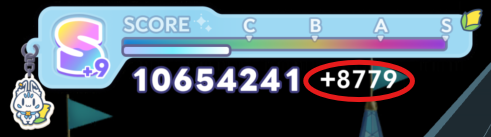 | `TT-Ro GSan Serif StdN B` |

**スキンの装飾**

| 名前 | 説明 | デフォルト |
| --- | --- | :---: |
| キーホルダー<br>`file` | 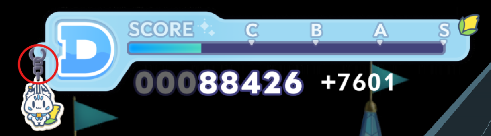 | - |
| アクリル作品<br>`file` | 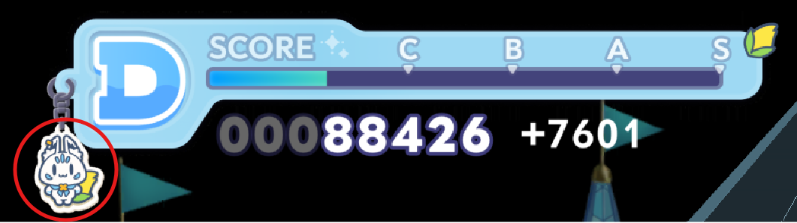 | - |
| ステッカー<br>`file` | 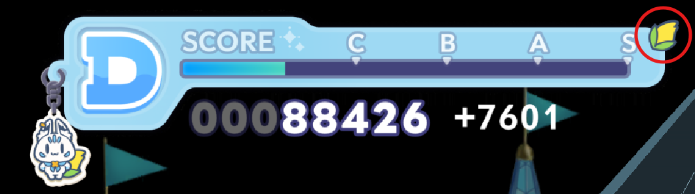 | - |

## ライフ@holodOverlay

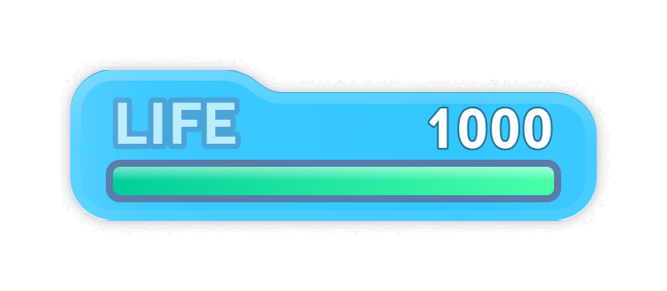

### 概要

| 名前 | 説明 | デフォルト | 範囲 |
| --- | --- | :---: | :---: |
| スキンタイプを設定に同期<br>`check` | [設定@holodOverlay](#設定holodoverlay)からスキンタイプの値を同期する | ON | - |
| スキンタイプ<br>`track` | [スキンタイプ一覧](#スキンタイプ一覧)で、使用するスキンタイプを選択する<br><i>- このトラックバーは、「スキンタイプを設定に同期」が無効になっている場合に表示されます。</i> | 1 | 1 ~ 56 |
| アニメーション速度<br>`value` | アニメーション速度を調整する | 1.00 | - |
| 最大ライフ値<br>`track` | バーが完全に埋まるまでのLIFEの量 | 1000 | 1 ~ 99999 |
| LIFE値<br>`text` | 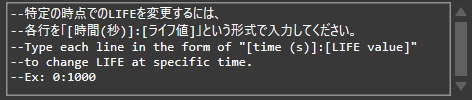 | - | - |

### ライブスキン（カスタム）
「カスタムスキン」が有効になっている場合、以下のオプションが表示されます。

| 名前 | 説明 | デフォルト |
| --- | --- | :---: |
| ライフの色<br>`color` | ライフにおけるベースの色 | `28c3ff` |
| フォント<br>`font` | LIFE値のフォント<br>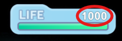 | `TT-Ro GSan Serif StdN B` |

## 一時停止@holodOverlay


### 概要

| 名前 | 説明 | デフォルト | 範囲 |
| --- | --- | :---: | :---: |
| スキンタイプを設定に同期<br>`check` | [設定@holodOverlay](#設定holodoverlay)からスキンタイプの値を同期する | ON | - |
| スキンタイプ<br>`track` | [スキンタイプ一覧](#スキンタイプ一覧)で、使用するスキンタイプを選択する<br><i>- このトラックバーは、「スキンタイプを設定に同期」が無効になっている場合に表示されます。</i> | 1 | 1 ~ 56 |
| 一時停止無効<br>`check` | 一時停止ボタンをグレー表示にする | OFF | - |

### ライブスキン（カスタム）
「カスタムスキン」が有効になっている場合、以下のオプションが表示されます。

| 名前 | 説明 | デフォルト |
| --- | --- | :---: |
| 一時停止の色<br>`color` | 一時停止におけるベースの色 | `5fdcf0` |

## コンボ@holodOverlay

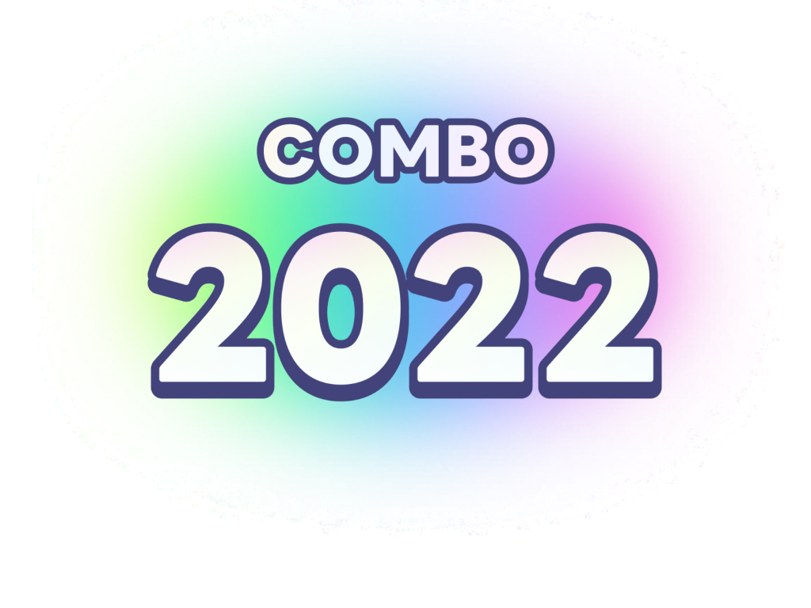

### 概要

| 名前 | 説明 | デフォルト | 範囲 |
| --- | --- | :---: | :---: |
| X軸境界<br>`track` | 要素内の描画領域の幅を調整する<br><i>- 非常に大きな数値を使用する場合、このトラックバーが必要になることがあります。</i> | 1024 | 0 ~ 9999 |
| スキンタイプを設定に同期<br>`check` | [設定@holodOverlay](#設定holodoverlay)からスキンタイプの値を同期する | ON | - |
| スキンタイプ<br>`track` | [スキンタイプ一覧](#スキンタイプ一覧)で、使用するスキンタイプを選択する<br><i>- このトラックバーは、「スキンタイプを設定に同期」が無効になっている場合に表示されます。</i> | 1 | 1 ~ 56 |
| アニメーション速度<br>`value` | アニメーション速度を調整する | 1.00 | - |
| AP/FC<br>`track` | コンボの背景に表示するクリアタイプを設定する<br>`0` = OFF, `1` = FC, `2` = AP | 2 | 0 ~ 2 |
| 0コンボを表示<br>`check` | 最初のイベントの前に0番目のコンボを表示するかどうかを切り替える | OFF | - |

### ライブスキン（カスタム）
「カスタムスキン」が有効になっている場合、以下のオプションが表示されます。

| 名前 | 説明 | デフォルト |
| --- | --- | :---: |
| 数字の 0 ~ 9<br>`file` | 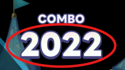 | - |
| コンボラベル<br>`file` | 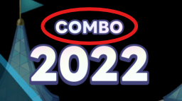 | - |

## 判定@holodOverlay

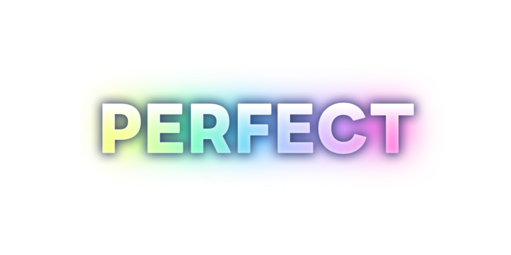

### 概要

| 名前 | 説明 | デフォルト | 範囲 |
| --- | --- | :---: | :---: |
| X軸境界<br>`track` | 要素内の描画領域の幅を調整する | 1024 | 0 ~ 9999 |
| スキンタイプを設定に同期<br>`check` | [設定@holodOverlay](#設定holodoverlay)からスキンタイプの値を同期する | ON | - |
| スキンタイプ<br>`track` | [スキンタイプ一覧](#スキンタイプ一覧)で、使用するスキンタイプを選択する<br><i>- このトラックバーは、「スキンタイプを設定に同期」が無効になっている場合に表示されます。</i> | 1 | 1 ~ 56 |
| アニメーション速度<br>`value` | アニメーション速度を調整する | 1.00 | - |
| 判定タイプ<br>`track` | 表示する判定の種類を設定する | 1 | 1 ~ 6 |
| 判定を無期限に表示する<br>`check` | イベント期間中ずっと表示されたままになる判定の表示を切り替える | OFF | - |

### ライブスキン（カスタム）
「カスタムスキン」が有効になっている場合、以下のオプションが表示されます。

| 名前 | 説明 | デフォルト |
| --- | --- | :---: |
| 判定の1<br>`file` | 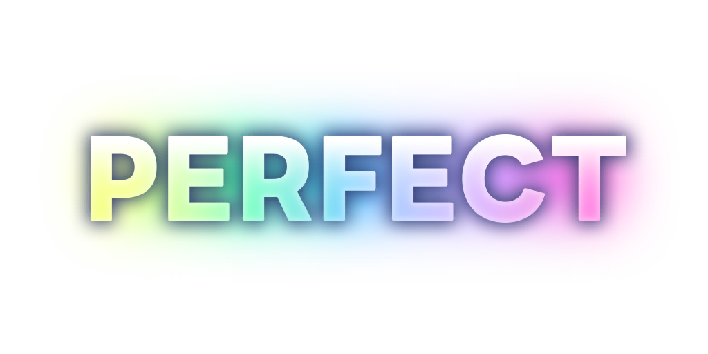 | - |
| 判定の2<br>`file` |  | - |
| 判定の3<br>`file` |  | - |
| 判定の4<br>`file` |  | - |
| 判定の5<br>`file` |  | - |
| 判定の6<br>`file` |  | - |

# よくある問題
### システムロケールの変更
システムロケールを「日本語（日本）」に変更してください：
`設定 > 時間と言語 > 言語 > 管理言語設定 > 「管理」タブ > システムロケールの変更`


### インポート時のアニメーション速度低下
`ファイル > プロジェクトを新規作成` を選択し、フレームレートを60に設定してください。この変更は今後のインポートに反映されます。


# 追加情報

## スキンタイプ一覧
以下に、すべてのホロメンスキンの設定を順に一覧表示します。

```lua
Code = { -- internal ID, score, life, pause, score decoration
  "default-01", 0x28c3ff, 0x28c3ff, 0x5fdcf0, 0, -- 1. Default
  "00001", 0x6878ff, 0x6878ff, 0xfd368a, 1,      -- 2. Tokina Sora
  "00002", 0xff6187, 0xff6187, 0xfd91b7, 1,      -- 3. Robocosan
  "00004", 0xabe64d, 0xabe64d, 0xff4991, 1,      -- 4. AZKi
  "00005", 0xe5395b, 0xe5395b, 0x0046b3, 1,      -- 5. Sakura Miko
  "00006", 0x93d5f2, 0x93d5f2, 0x65637f, 1,      -- 6. Hoshimachi Suisei
  "00007", 0xffcb30, 0xffcb30, 0x8dd600, 1,      -- 7. Aki Rosenthal
  "00010", 0xdd305b, 0xdd305b, 0x8a6f72, 1,      -- 8. Akai Haato
  "00011", 0xff5487, 0xff5487, 0xff85bc, 1,      -- 9. Shirakami Fubuki
  "00012", 0xe5ce00, 0xe5ce00, 0x5cd0dc, 1,      -- 10. Natsuiro Matsuri
  "00013", 0xf081a3, 0xf081a3, 0x634c59, 1,      -- 11. Nakiri Ayame
  "00014", 0xdb3131, 0xdb3131, 0x575769, 1,      -- 12. Yuzuki Choco
  "00015", 0xff909e, 0xff909e, 0xdd3654, 1,      -- 13. Oozora Subaru
  "00016", 0xd866ed, 0xd866ed, 0x9a70f3, 1,      -- 14. Ookami Mio
  "00017", 0xffcd28, 0xffcd28, 0xff637c, 1,      -- 15. Nekomata Okayu
  "00018", 0x75c0ff, 0x75c0ff, 0x2b2d80, 1,      -- 16. Inugami Korone
  "00019", 0x57a9ff, 0x57a9ff, 0x97daef, 1,      -- 17. Usada Pekora
  "00021", 0xffab2d, 0xffab2d, 0x4ab0e9, 1,      -- 18. Shiranui Flare
  "00022", 0xa5b5b7, 0xa5b5b7, 0x4f6e8f, 1,      -- 19. Shirogane Noel
  "00023", 0xc2153b, 0xc2153b, 0x453748, 1,      -- 20. Houshou Marine
  "00026", 0xe2d065, 0xe2d065, 0xff8f96, 1,      -- 21. Tsunomaki Watame
  "00027", 0xb77fff, 0xb77fff, 0xfc96dc, 1,      -- 22. Tokoyami Towa
  "00028", 0xff93d0, 0xff93d0, 0x99c6ff, 1,      -- 23. Himemori Luna
  "00030", 0x49aaff, 0x49aaff, 0x5cceff, 1,      -- 24. Yukihana Lamy
  "00031", 0xffc633, 0xffc633, 0xff852d, 1,      -- 25. Momosuzu Nene
  "00032", 0x757575, 0x757575, 0x91c1b1, 1,      -- 26. Shishiro Botan
  "00034", 0xed0043, 0xed0043, 0x0083eb, 1,      -- 27. Omaru Polka
  "00035", 0x9464d2, 0x9464d2, 0x493a58, 1,      -- 28. La+ Darknesss
  "00036", 0x831550, 0x831550, 0x41282e, 1,      -- 29. Takane Lui
  "00037", 0xff95c8, 0xff95c8, 0x52dfce, 1,      -- 30. Hakui Koyori
  "00039", 0x5ecfc8, 0x5ecfc8, 0xd5c293, 1,      -- 31. Kazama Iroha
  "03001", 0xffaaaa, 0xffaaaa, 0x9f7060, 1,      -- 32. Ayunda Risu
  "03002", 0xaa83ff, 0xaa83ff, 0xfad443, 1,      -- 33. Moona Hoshinova
  "03003", 0x9cdf36, 0x9cdf36, 0xfda2bb, 1,      -- 34. Airani Iofifteen
  "03004", 0xc40041, 0xc40041, 0x394452, 1,      -- 35. Kureiji Ollie
  "03005", 0xf3bf41, 0xf3bf41, 0xb3906f, 1,      -- 36. Anya Melfissa
  "03006", 0x004dc2, 0x004dc2, 0x5ac6b6, 1,      -- 37. Pavolia Reine
  "03007", 0x9290a1, 0x9290a1, 0x7e95ed, 1,      -- 38. Vestia Zeta
  "03008", 0xfc4045, 0xfc4045, 0x54291a, 1,      -- 39. Kaela Kovalskia
  "03009", 0x50cfe1, 0x50cfe1, 0x63668e, 1,      -- 40. Kobo Kanaeru
  "04001", 0xe01c61, 0xe01c61, 0xff8eb8, 1,      -- 41. Mori Calliope
  "04002", 0xff792e, 0xff792e, 0x38d2a8, 1,      -- 42. Takanashi Kiara
  "04003", 0x5d4e83, 0x5d4e83, 0xff8d35, 1,      -- 43. Ninomae Ina'nis
  "04007", 0xdf185d, 0xdf185d, 0x60ced0, 1,      -- 44. IRyS
  "04010", 0x2221aa, 0x2221aa, 0xdcb33e, 1,      -- 45. Ouro Kronii
  "04012", 0xee2222, 0xee2222, 0x48d5c8, 1,      -- 46. Hakos Baelz
  "04013", 0xc288f7, 0xc288f7, 0x44445d, 1,      -- 47. Shiori Novella
  "04014", 0x8674ff, 0x8674ff, 0xffa7ca, 1,      -- 48. Koseki Bijou
  "04015", 0x3950ee, 0x3950ee, 0x3f3d53, 1,      -- 49. Nerissa Ravencroft
  "04016", 0x67b2ff, 0x67b2ff, 0xf7a6ca, 1,      -- 50. Fuwawa Abyssgard*
  "04017", 0xf7a6ca, 0xf7a6ca, 0x67b2ff, 1,      -- 51. Mococo Abyssgard*
  "06002", 0xffd380, 0xffd380, 0xfc8275, 1,      -- 52. Otonose Kanade
  "06003", 0xff77a9, 0xff77a9, 0x9d8dff, 1,      -- 53. Ichijou Ririka
  "06004", 0x357b6c, 0x357b6c, 0xd7845a, 1,      -- 54. Juufuutei Raden
  "06005", 0xa4aaff, 0xa4aaff, 0xdec2a7, 1,      -- 55. Todoroki Hajime
  "80001", 0x67b2ff, 0xf7a6ca, 0x67b2ff, 1,      -- 56. FUWAMOCO
} -- *No Live Skin in-game, but technically supported
```